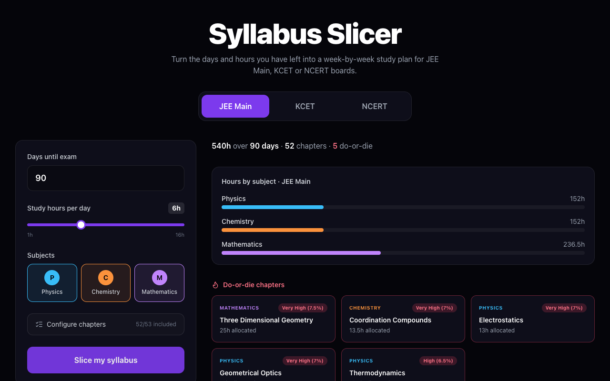

# Syllabus Slicer

A small web tool that turns "I have N days and H hours a day" into a week-by-week study plan for JEE Main, KCET or
NCERT boards. It splits the hours between subjects and chapters by weight and marks the highest-weight chapters as
"do or die". It runs entirely in the browser, with no backend, no account and no network calls after the page loads.

Try it live: **https://saifcs50-cs50.github.io/syllabus-slicer/**



## What it does

JEE Main and KCET cover Physics, Chemistry and Maths. The NCERT / board mode adds Computer Science, English and
Hindi. You enter the days left and your hours per day (1 to 16, in half-hour steps), and the plan shows hours per
subject and chapter, the high-weight chapters and a weekly timeline. A chapter that doesn't fit in one week is split
across weeks.

You can switch single chapters in or out for each exam. Those choices stay in your browser's `localStorage` and are
never sent anywhere.

## How the plan is calculated

1. Total hours = days × hours per day.
2. Each selected subject gets a share of those hours, proportional to its paper weight for the chosen exam.
3. Inside a subject, each included chapter gets a share proportional to its chapter weight (minimum half an hour).
4. Chapters are interleaved across subjects, highest weight first, and packed into weeks.

Labels such as "Very High (7.5%)" are computed from the same weights the planner uses, so a label can't drift
away from its number. The weights live in [`src/data/syllabus.ts`](src/data/syllabus.ts) and the maths in
[`src/lib/slicerEngine.ts`](src/lib/slicerEngine.ts).

## The weights are rough

The chapter weights (roughly 0 to 10) and the subject weights are my own estimates for planning. They are not
official figures from any exam body.

- The JEE Main split (35% Maths, 22.5% Physics, 22.5% Chemistry) deliberately leans towards Maths. The real paper
  is roughly equal across the three subjects.
- The Computer Science, English and Hindi chapter lists are generic groupings. Check them against your own board's
  syllabus and adjust them with the chapter list.
- Chapter names follow the usual public syllabus headings. No textbook text is included.

Treat the plan as a starting point and edit the data file to fit your syllabus.

## Run it

You need Node.js 20.19 or newer (or 22.12 or newer), which is what Vite 8 requires.

```bash
npm ci
npm run dev
```

Then open the address Vite prints (by default `http://localhost:5173`).

Other scripts:

```bash
npm run build     # type-check and build to dist/
npm run preview   # serve the built files locally
npm run lint      # oxlint
```

The live demo is the same build with GitHub Pages' sub-path: `npx vite build --base=/syllabus-slicer/`.

There is no automated test suite yet.

## Built with

React 19, TypeScript, Vite, Tailwind CSS 4, Framer Motion and Lucide icons.

## Licence

[MIT](LICENSE). Not affiliated with, or endorsed by, any exam body, board or coaching institute.
